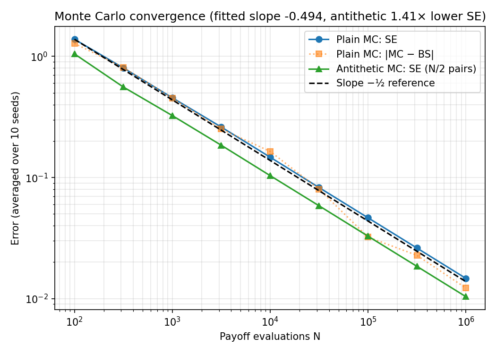
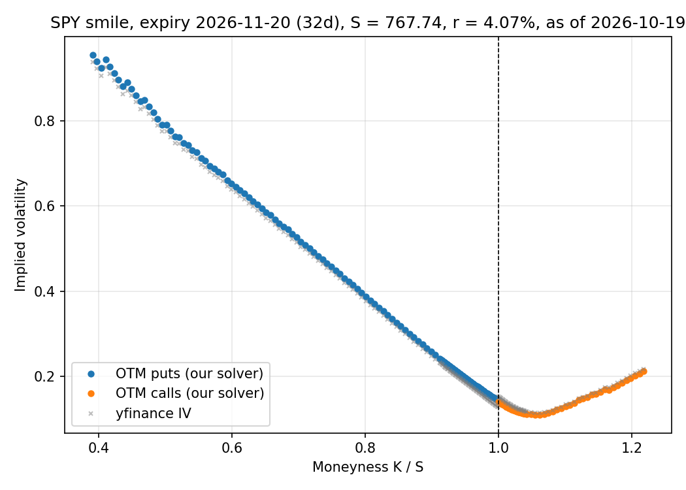

# Options Pricing & Volatility Smile

A Black–Scholes pricer validated against an independent Monte Carlo pricer, an implied volatility solver, and a volatility smile extracted from a live SPY option chain.





## Results

Test case: S = K = 100, T = 1, r = 5%, σ = 20%.

| Quantity | Value |
|---|---|
| Black–Scholes call | 10.4506 |
| Monte Carlo call (N = 10⁶) | 10.4697 ± 0.0147 (1.3 SE from BS) |
| Fitted convergence slope (log SE vs log N) | −0.494 (theory: −0.5) |
| Antithetic SE reduction at equal compute | 1.41× (≈ 2× lower variance) |

Antithetic variates are compared at equal cost: N/2 antithetic pairs vs N plain paths, with the SE taken over pair averages.

**SPY smile** (snapshot 2026-10-19): spot 767.74, expiry 2026-11-20 (32 days), r = 4.07% (13-week T-bill, `^IRX`). Out-of-the-money puts below spot and calls above, inverted with this repo's own solver. Implied vol falls from about 95% at K/S = 0.4 to a minimum of about 11% just above the money, then rises gently on the call side. That is a strong downward skew. Under Black–Scholes the line would be flat. Results agree closely with yfinance's `impliedVolatility` column.

## Contents

- `pricing.py`: `bs_call`, `bs_put`, `mc_call` (returns price and standard error, optional antithetic variates), `implied_vol` (Brent's method on [1e-4, 5], returns NaN outside no-arbitrage bounds).
- `plots.py`: generates both figures in `figures/`.
- `tests/test_pricing.py`: BS reference value, put–call parity, implied vol round trip and out-of-bounds handling, MC vs BS within 3 SE, martingale check on e^{−rT}S_T.

## How to run

```bash
pip install -r requirements.txt
python plots.py
pytest
```

`plots.py` pulls a fresh chain, so the smile figure and numbers will differ from the snapshot above.

## Limitations

- Constant risk-free rate, flat across maturities.
- Dividends ignored (SPY pays a dividend yield of roughly 1%, which biases put/call vols slightly).
- Yahoo Finance quotes are delayed and not always synchronised with the spot price.
- A single snapshot of a single expiry.
- Mid prices are used even where bid–ask spreads are wide, and deep OTM quotes make implied vol ill-conditioned.
- European pricing applied to American-style SPY options.

## Next step

Fit a stochastic volatility model (Heston) that can reproduce the skew, as a first step towards deep-learning volatility calibration.
